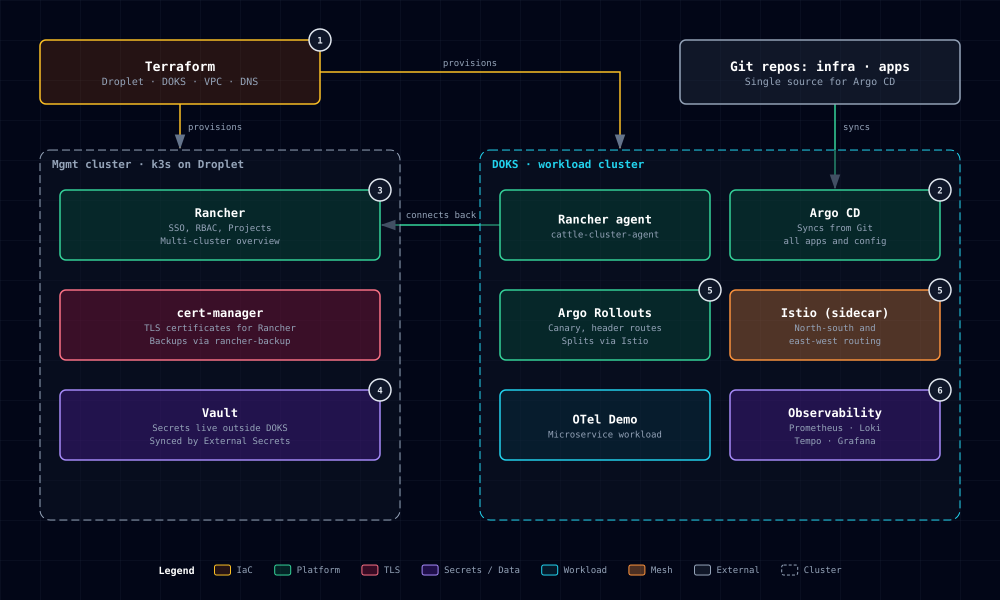

# doks-prod-lab

Simulates a production-grade environment to practice day-to-day Kubernetes cluster operations.

## Architecture



See [docs/architecture.md](docs/architecture.md) for the detail diagrams.

## Stack

- **DigitalOcean Kubernetes (DOKS)**: provisioned via Terraform
- **Terraform**: S3-compatible backend on DigitalOcean Spaces
- **k3s on a Droplet**: management cluster running Rancher and cert-manager
- **Rancher**: access, RBAC and multi-cluster overview; DOKS is imported as a Registered cluster
- **Argo CD**: GitOps on DOKS, syncs the platform from this repo

## Structure

```text
.
|-- README.md
|-- bootstrap
|   |-- argocd.sh             # installs Argo CD on DOKS and hands over to Git
|   |-- import-doks.sh        # registers DOKS in Rancher through the Rancher API
|   `-- rancher.sh            # installs cert-manager + Rancher on the management cluster
|-- docs
|   |-- ARGOCD.md              # bootstrap/argocd.sh walkthrough, app of apps, AppProjects
|   |-- BRINGUP.md             # scripts/up.sh walkthrough
|   |-- RANCHER.md             # bootstrap/rancher.sh + import-doks.sh walkthrough
|   |-- TEARDOWN.md            # scripts/down.sh walkthrough
|   |-- VERSIONS.md            # Rancher / cert-manager / DOKS / k3s / Argo CD version matrix
|   |-- architecture.md        # architecture overview and detail diagrams (zh: architecture.zh.md)
|   `-- images                 # architecture diagrams (SVG)
|-- platform                   # everything Argo CD deploys
|   |-- apps
|   |   `-- namespaces.yaml    # Application: syncs platform/namespaces
|   |-- argocd
|   |   |-- projects.yaml      # AppProjects: platform, apps
|   |   |-- root-app.yaml      # root Application ("app of apps"), syncs platform/apps
|   |   `-- values.yaml        # Argo CD Helm values
|   `-- namespaces
|       `-- namespaces.yaml    # observability, otel-demo
|-- scripts
|   |-- down.sh                # teardown: removes billable resources after a lab session
|   `-- up.sh                  # bring-up: provisions DOKS + management k3s
`-- terraform
    |-- API_TOKEN_SCOPES.md    # required DigitalOcean API token scopes
    |-- envs
    |   `-- lab                 # lab environment (root module)
    |       |-- backend.tf
    |       |-- main.tf
    |       |-- outputs.tf
    |       |-- variables.tf
    |       `-- versions.tf
    `-- modules
        |-- doks                 # reusable DOKS cluster module
        |   |-- main.tf
        |   |-- outputs.tf
        |   |-- variables.tf
        |   `-- versions.tf
        `-- mgmt-k3s              # single-node k3s management cluster module
            |-- cloud-init.yaml.tftpl
            |-- main.tf
            |-- outputs.tf
            `-- variables.tf
```

## Prerequisites

- `terraform` >= 1.6
- `doctl` (authenticated), `kubectl`, `helm`, `jq`, `dig`, `openssl`
- An SSH key already uploaded to the DigitalOcean account (for the management Droplet).
  If it has a passphrase, load it into `ssh-agent` first
- An existing DigitalOcean DNS zone, created once by hand (for the Rancher hostname)
- Environment variables:
  - `DIGITALOCEAN_TOKEN`, `AWS_ACCESS_KEY_ID`, `AWS_SECRET_ACCESS_KEY` (Spaces keys for the Terraform backend)
    - Required API token scopes for `DIGITALOCEAN_TOKEN`: see [terraform/API_TOKEN_SCOPES.md](terraform/API_TOKEN_SCOPES.md)
  - `LETSENCRYPT_EMAIL` (used by `bootstrap/rancher.sh` to request the Rancher certificate)
  - Optional: `ADMIN_CIDR_PREFIX=24` on CGNAT networks (see [docs/BRINGUP.md](docs/BRINGUP.md#cgnat-networks))
- This repo pushed to GitHub: Argo CD syncs from its `main` branch (see [docs/ARGOCD.md](docs/ARGOCD.md))

## Usage

```bash
# bring up DOKS + the management k3s cluster
./scripts/up.sh

# install cert-manager + Rancher, then import DOKS into it (see docs/RANCHER.md)
./bootstrap/rancher.sh
./bootstrap/import-doks.sh

# install Argo CD on DOKS; Git takes over from here (see docs/ARGOCD.md)
./bootstrap/argocd.sh

# tear down (deletes billable resources, keeps the Spaces bucket and DNS zone)
./scripts/down.sh
```

See [docs/BRINGUP.md](docs/BRINGUP.md) for the full bring-up walkthrough.

## Guides

- [docs/BRINGUP.md](docs/BRINGUP.md): first bring-up with `scripts/up.sh`, DNS requirements
- [docs/VERSIONS.md](docs/VERSIONS.md): Rancher / cert-manager / DOKS / k3s version matrix
- [docs/RANCHER.md](docs/RANCHER.md): `bootstrap/rancher.sh`, certificate caching, importing DOKS with `bootstrap/import-doks.sh`
- [docs/ARGOCD.md](docs/ARGOCD.md): `bootstrap/argocd.sh`, app of apps, AppProjects
- [docs/architecture.md](docs/architecture.md): architecture overview and detail diagrams
- [docs/TEARDOWN.md](docs/TEARDOWN.md): `scripts/down.sh`, destroy retries, leftover checks
- [terraform/API_TOKEN_SCOPES.md](terraform/API_TOKEN_SCOPES.md): required DigitalOcean API token scopes
