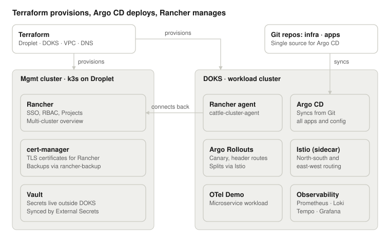

# doks-prod-lab

Simulates a production-grade environment to practice day-to-day Kubernetes cluster operations.

## Architecture



## Stack

- **DigitalOcean Kubernetes (DOKS)**: provisioned via Terraform
- **Terraform**: S3-compatible backend on DigitalOcean Spaces

## Structure

```text
.
|-- README.md
|-- scripts
|   `-- down.sh              # teardown: removes billable resources after a lab session
`-- terraform
    |-- API_TOKEN_SCOPES.md  # required DigitalOcean API token scopes
    |-- envs
    |   `-- lab               # lab environment (root module)
    |       |-- backend.tf
    |       |-- main.tf
    |       |-- outputs.tf
    |       |-- variables.tf
    |       `-- versions.tf
    `-- modules
        `-- doks               # reusable DOKS cluster module
            |-- main.tf
            |-- outputs.tf
            |-- variables.tf
            `-- versions.tf
```

## Prerequisites

- `terraform` >= 1.6
- `doctl` (authenticated)
- `kubectl`
- Environment variables: `DIGITALOCEAN_TOKEN`, `AWS_ACCESS_KEY_ID`, `AWS_SECRET_ACCESS_KEY` (Spaces keys for the Terraform backend)
  - Required API token scopes for `DIGITALOCEAN_TOKEN`: see [terraform/API_TOKEN_SCOPES.md](terraform/API_TOKEN_SCOPES.md)

## Usage

```bash
# provision
terraform -chdir=terraform/envs/lab init
terraform -chdir=terraform/envs/lab apply

# tear down (deletes billable resources, keeps the Spaces bucket)
./scripts/down.sh
```
