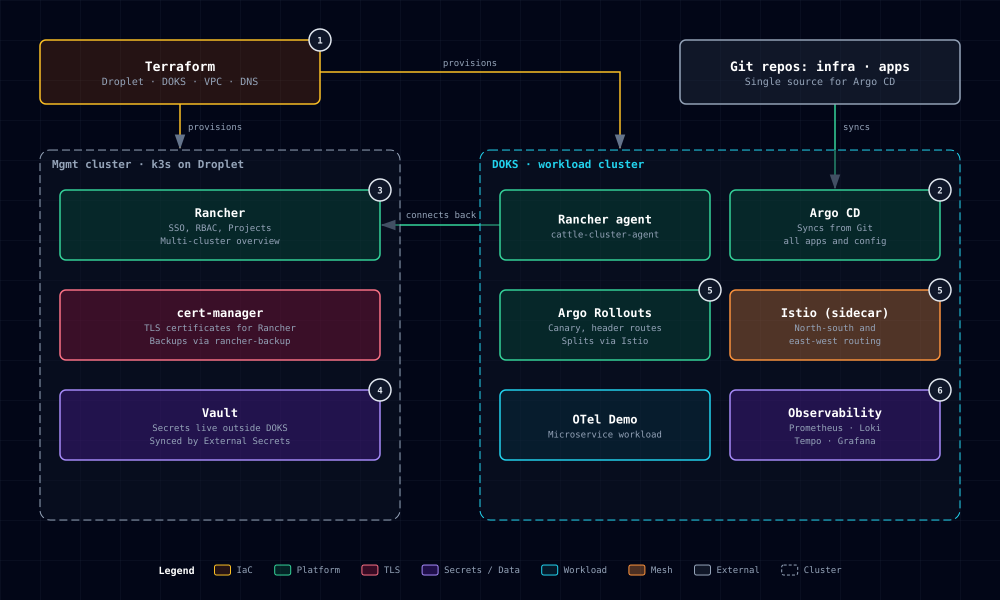
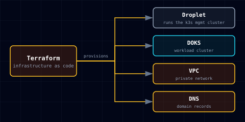
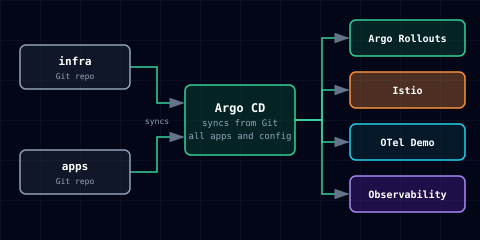
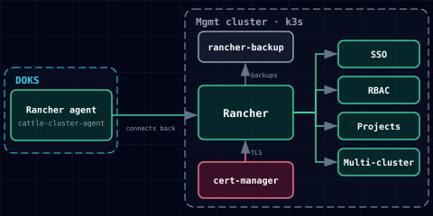
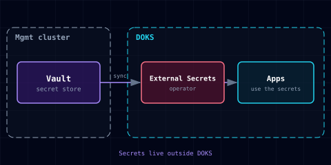
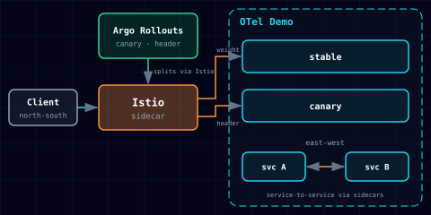
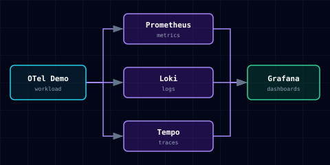

# Architecture

English | [繁體中文](architecture.zh.md)

Terraform provisions, Argo CD deploys, Rancher manages. A k3s management cluster runs Rancher, cert-manager and Vault; a DOKS workload cluster runs the apps.

The numbers on the overview match the sections below.

## 1. Provisioning · Terraform

Terraform creates the infrastructure for both clusters: the Droplet that runs the k3s management cluster, the DOKS workload cluster, the VPC and the DNS records.

## 2. GitOps · Argo CD

Argo CD runs on DOKS and syncs from the infra and apps Git repos. Git is the single source: every app and config on the cluster, including Argo Rollouts, Istio, the OTel Demo and the observability stack, is deployed from there.

## 3. Management · Rancher

The Rancher agent (cattle-cluster-agent) on DOKS connects back to Rancher on the management cluster. Rancher provides SSO, RBAC, Projects and a multi-cluster overview. cert-manager issues Rancher's TLS certificates, and rancher-backup takes backups.

## 4. Secrets · Vault

Secrets live in Vault on the management cluster, outside DOKS. External Secrets on DOKS syncs them into the cluster for the apps to use.

## 5. Traffic · Istio + Argo Rollouts

Istio sidecars handle both north-south (incoming) and east-west (service-to-service) routing. Argo Rollouts runs canary releases and header-based routes, and uses Istio to split traffic between the stable and canary versions.

## 6. Observability

The observability stack collects from the OTel Demo: Prometheus for metrics, Loki for logs, Tempo for traces, and Grafana to view them together.
