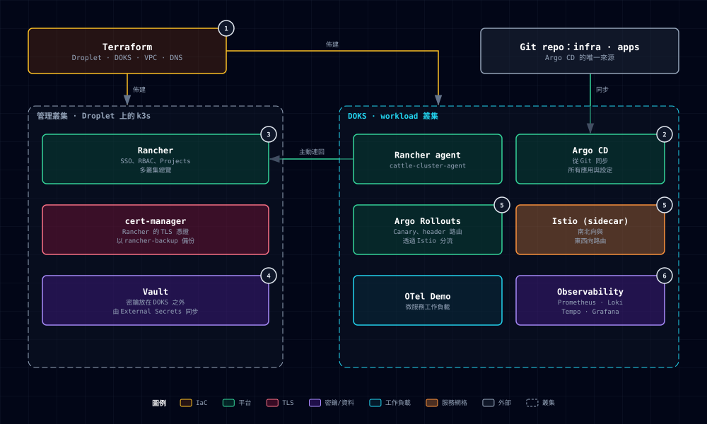
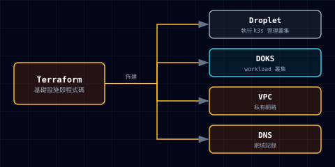
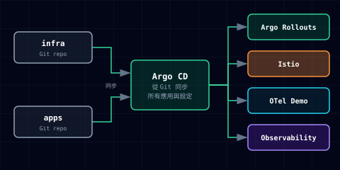
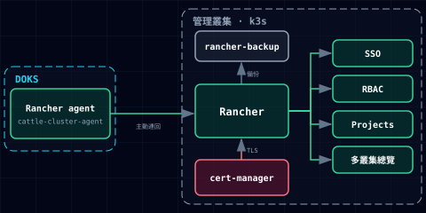
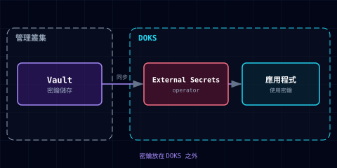
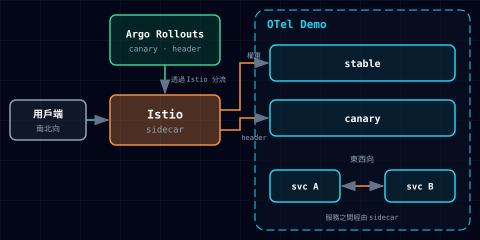
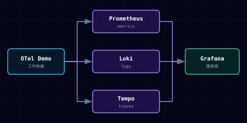

# 架構

[English](architecture.md) | 繁體中文

Terraform 佈建、Argo CD 部署、Rancher 管理。k3s 管理叢集執行 Rancher、cert-manager 與 Vault；DOKS workload 叢集執行應用程式。

總覽圖上的編號對應下面各章節。

## 1. 佈建 · Terraform

Terraform 建立兩個叢集需要的基礎設施：執行 k3s 管理叢集的 Droplet、DOKS workload 叢集、VPC 和 DNS 記錄。

## 2. GitOps · Argo CD

Argo CD 跑在 DOKS 上，從 infra 和 apps 兩個 Git repo 同步。Git 是唯一來源：叢集上所有應用與設定，包括 Argo Rollouts、Istio、OTel Demo 和可觀測性堆疊，都從這裡部署。

## 3. 管理 · Rancher

DOKS 上的 Rancher agent（cattle-cluster-agent）主動連回管理叢集上的 Rancher。Rancher 提供 SSO、RBAC、Projects 與多叢集總覽；cert-manager 負責 Rancher 的 TLS 憑證，rancher-backup 負責備份。

## 4. 密鑰 · Vault

密鑰存放在管理叢集的 Vault，不在 DOKS 裡。DOKS 上的 External Secrets 把密鑰同步進叢集，供應用程式使用。

## 5. 流量 · Istio + Argo Rollouts

Istio sidecar 同時處理南北向（外部進來）與東西向（服務之間）的路由。Argo Rollouts 負責 canary 發佈與 header 路由，透過 Istio 在 stable 與 canary 版本之間分流。

## 6. 可觀測性

可觀測性堆疊從 OTel Demo 收集資料：Prometheus 收 metrics、Loki 收 logs、Tempo 收 traces，再由 Grafana 統一查看。
